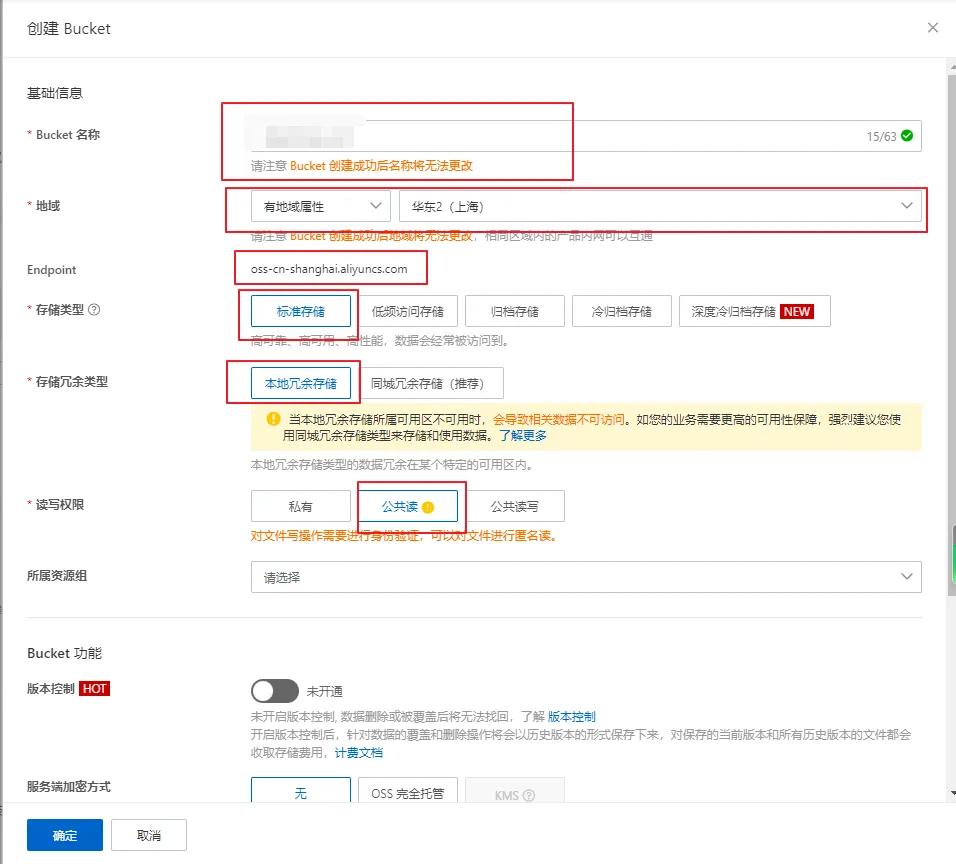
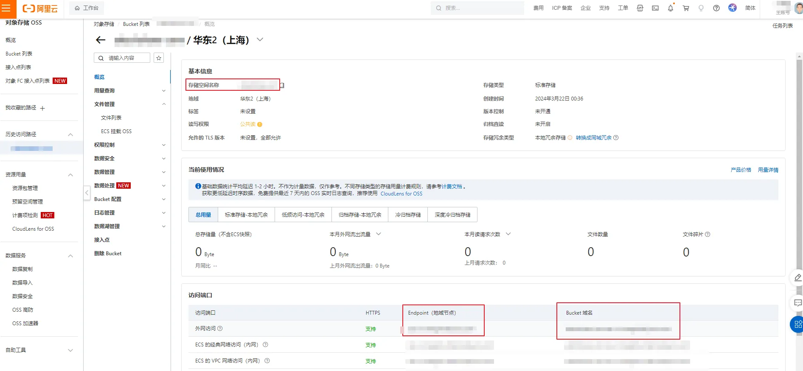
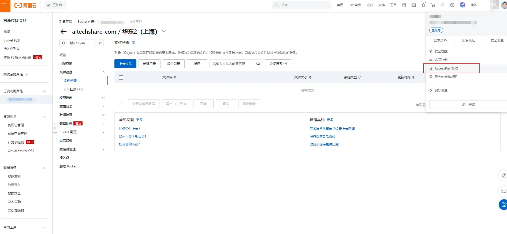
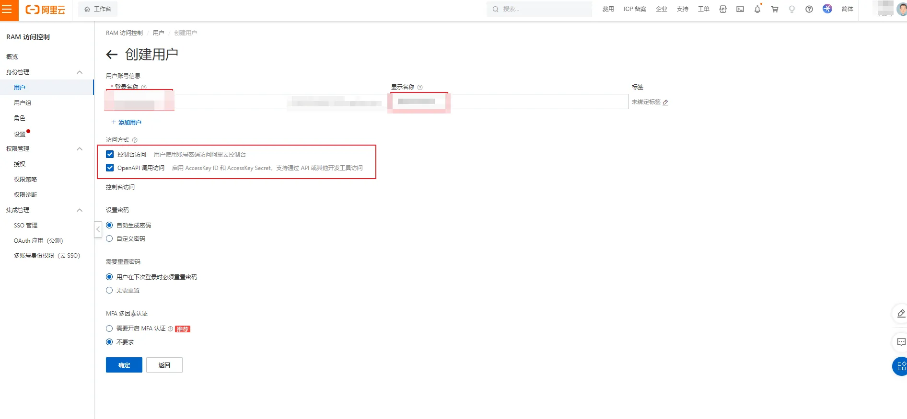
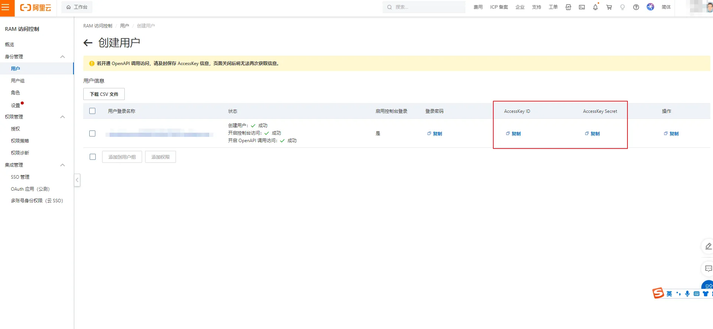
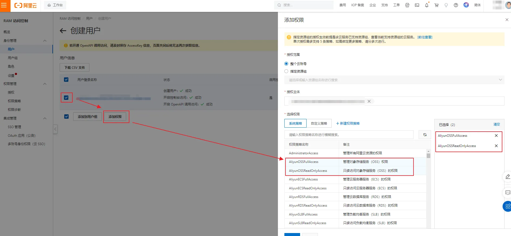

# 配置 阿里云 OSS 为个人图床

## 写在前面

使用阿里云 OSS 做图床之前，需要先注册阿里云账号并开通对象存储 OSS 服务：

[https://www.aliyun.com/](https://www.aliyun.com/)

OSS 按量计费，个人图床的图片量级下费用极低（标准存储 0.12 元/GB/月，外网流出流量约 0.25~0.5 元/GB，通常每月几毛钱以内），无需预付费套餐；新用户一般还有免费试用额度。

> 阿里云 OSS 通过 S3 兼容协议接入，App 内不需要安装任何厂商 SDK。配置入口：图床管理 → 新增图床 → 选择「阿里云 OSS」。

## 配置需要的参数

+ Access Key（AccessKeyId，LTAI 开头）
+ Access Secret（AccessKey Secret）
+ Bucket（存储桶名称）
+ 地域（Region，如 oss-cn-beijing）
+ Endpoint（如 oss-cn-beijing.aliyuncs.com，填了地域可自动推导）

## 第一步：创建 Bucket

打开 OSS 控制台的 Bucket 列表页：

[https://oss.console.aliyun.com/bucket](https://oss.console.aliyun.com/bucket)

点击「创建 Bucket」，注意以下几项（其他保持默认即可）：

+ **Bucket 名称**：全局唯一，小写字母开头，可含数字和中划线，例如 `gudong-img-bucket`，创建后不可更改。App 里只填这个名称，不带地域后缀。
+ **地域**：选「有地域属性」并挑离你近的（如华东 2（上海）对应 `oss-cn-shanghai`、华北 2（北京）对应 `oss-cn-beijing`）。创建表单里选完地域会直接显示对应的 Endpoint。
+ **存储类型 / 存储冗余**：标准存储 + 本地冗余即可，图床用不上冷归档和同城冗余。
+ **读写权限**：做图床需要「**公共读**」（图片链接可直接在浏览器打开）。

> **注意**：新版控制台创建 Bucket 时默认开启「阻止公共访问」，此时读写权限只能选私有。想用公共读图床，需要创建完成后进入该 Bucket → 权限控制 → 阻止公共访问，先关闭开关，再把读写权限改为「公共读」。
>
> 如果想保持私有读写也可以：不关「阻止公共访问」，但在 App 高级配置里必须填写「公开访问域名」（如绑定了 CDN 的自定义域名），否则上传成功后拿不到能直接访问的图片链接。

## 第二步：查看 Bucket 概览，记下参数

进入刚创建的 Bucket，点击左侧「概览」，上半部分是 Bucket 名称和地域，下半部分「访问端口」表格里可以看到外网访问的 Endpoint（地域节点）和 Bucket 域名：

把 **Bucket 名称** 和 **外网 Endpoint**（形如 `oss-cn-shanghai.aliyuncs.com`）记下来，发送到手机备用。

## 第三步：获取 AccessKey

**强烈建议使用 RAM 子账号的密钥，不要使用阿里云主账号的 AccessKey**——子账号密钥泄露后影响范围可控，且可以随时单独吊销。

打开 RAM 控制台的用户列表页：

[https://ram.console.aliyun.com/users](https://ram.console.aliyun.com/users)

（也可以从控制台右上角头像菜单进入「AccessKey 管理」，再选择「开始使用子用户 AccessKey」）

点击「创建用户」，登录名称自定义，访问方式勾选「**OpenAPI 调用访问**」（控制台访问可不勾）：

创建成功后页面会显示该用户的 **AccessKey ID** 和 **AccessKey Secret**：

> AccessKey Secret 只在创建时完整显示一次，页面关闭后无法再查看，务必当场复制或下载 CSV 保存，发送到手机备用。

最后给这个子账号授权：在用户列表勾选该用户，点击「添加权限」，搜索并勾选 `AliyunOSSFullAccess`（管理对象存储服务（OSS）权限），点击确定：

## 第四步：在 App 中填写

打开 PicPlus 的阿里云 OSS 配置表单，逐项填入：

| 表单项 | 填什么 | 示例 |
|---|---|---|
| Access Key (RAM) | RAM 用户的 AccessKeyId | `LTAI5t...` |
| Access Secret | 对应的 AccessKey Secret | — |
| Bucket | Bucket 名称（不带地域后缀） | `gudong-img-bucket` |
| 地域 (Region) | Bucket 概览页的地域 ID | `oss-cn-shanghai` |
| Endpoint | 所在地域的外网 Endpoint | `oss-cn-shanghai.aliyuncs.com` |

地域填 `cn-shanghai` 这种短写法也可以，App 会自动补全为 `oss-cn-shanghai` 并推导出 Endpoint；两项不一致时以 Bucket 实际地域为准。

**高级配置**（一般不用动）：

+ **存储路径**：图片在 Bucket 里的目录前缀，如 `images/blog`，留空则传到根目录。
+ **自动按日期分目录**：默认开启，图片按 `2026/11/02/` 这样的日期目录归类，方便回源管理。
+ **公开访问域名**：私有 Bucket 必填；公共读 Bucket 留空即可，图片链接形如 `https://<bucket>.<endpoint>/<路径>`。

填写完毕后，点击右上角的「测试一下」，测试成功后点小对勾保存配置即可正常使用。如果测试失败，会弹出具体的错误信息，按提示检查参数（最常见的是 Bucket 名称带了地域后缀、地域与 Bucket 实际地域不一致、Bucket 仍处于「阻止公共访问」状态、或 RAM 用户没有 OSS 权限）。

## 关于 PRO

阿里云 OSS 属于 PRO 图床：免费用户可以先试用上传 10 张（按成功上传次数累计），确认好用后再升级 PRO 不限量使用。上传记录的删除（本地 + 远端）不占额度，全免费。

## 其他

- PicPlus 下载地址：[去下载](/download)
- 阿里云 OSS 官方文档：[https://help.aliyun.com/product/31815.html](https://help.aliyun.com/product/31815.html)
- 文中控制台截图取自阿里云开发者社区教程[《手把手教你搭建阿里云图床》](https://developer.aliyun.com/article/1465963)，配图版权归原作者所有
